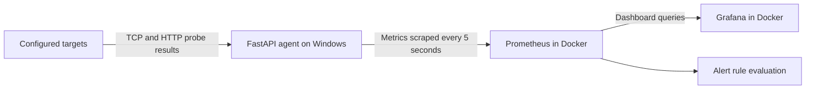

# Real-Time Network Health & Latency Monitoring Dashboard

Monitor TCP connectivity and HTTP/HTTPS availability, latency, and response codes with a Python FastAPI agent, Prometheus, and Grafana. Targets are configured in YAML and checked concurrently. A deliberately broken target demonstrates failure detection and alerting.

## How it works



FastAPI runs directly on the Windows host. Docker Compose runs **Prometheus and Grafana**. Prometheus reaches the agent at `host.docker.internal:8000/metrics`; Grafana reaches Prometheus at `http://prometheus:9090` inside the Docker network.

The agent waits **5 seconds after each probe cycle finishes** before starting the next cycle. Slow or unreachable targets extend the cycle. Prometheus scrapes independently every 5 seconds, and the dashboard can refresh every 5 seconds.

## Quick start on Windows

### 1. Prepare the environment

Install Python (the local setup has been verified with **Python 3.13**) and Docker Desktop with Docker Compose. Start Docker Desktop and wait for its Linux container engine to be ready. The setup uses ports `8000`, `9090`, and `3000`.

Open PowerShell in this project's root directory, then run these commands once:

```powershell
python -m venv .venv
.\.venv\Scripts\python.exe -m pip install -r requirements.txt
```

If `.venv` is already set up, reuse it. The commands below call its Python executable directly, so activating the environment is optional.

Create local configuration files if they do not already exist:

```powershell
if (-not (Test-Path .\config\targets.yaml)) {
    Copy-Item .\config\targets.example.yaml .\config\targets.yaml
}
if (-not (Test-Path .\.env)) {
    Copy-Item .\.env.example .\.env
}
```

Edit `.env` and replace `GRAFANA_ADMIN_PASSWORD` with your own password before starting Grafana. Your `.env` and `config/targets.yaml` are ignored by Git so credentials and personal monitoring targets stay local. The repository contains only example configuration.

### 2. Start the monitoring agent

In the first PowerShell terminal:

```powershell
.\.venv\Scripts\python.exe -m uvicorn app.main:app --host 0.0.0.0 --port 8000
```

Keep this terminal open. Binding to `0.0.0.0` allows the Docker containers to reach the host service. For development, append `--reload` to restart automatically after Python code changes.

### 3. Start Prometheus and Grafana

In a second PowerShell terminal, from the same project root:

```powershell
docker compose up -d
docker compose ps
```

Allow a few probe and scrape cycles for data to appear.

| Service | Open in your browser | Purpose |
| --- | --- | --- |
| Grafana | [localhost:3000](http://localhost:3000) | Live dashboards |
| Prometheus | [localhost:9090](http://localhost:9090) | Metric queries and alerts |
| FastAPI | [127.0.0.1:8000](http://127.0.0.1:8000) | Project information as JSON |
| Agent health | [127.0.0.1:8000/health](http://127.0.0.1:8000/health) | Monitoring loop status |
| Raw metrics | [127.0.0.1:8000/metrics](http://127.0.0.1:8000/metrics) | Latest exported measurements |

Grafana's initial username defaults to **`admin`**. Use the password you set in `.env`. For an existing Grafana installation, use its saved password; changing `.env` does not reset an account already stored in Grafana's data volume.

## View the Grafana dashboard

If Grafana was already configured, open **Dashboards** and select **Real-Time Network Health Dashboard**. Set the time range to **Last 15 minutes** and refresh to **5s**.

### First-time Grafana setup

The current Compose file persists Grafana data but does **not** mount the provisioning files in `deployments/grafana/`. A fresh installation therefore needs a data source and dashboard configured once.

1. In **Connections**, add a **Prometheus** data source.
2. Set its server URL to `http://prometheus:9090`, choose it as the default, and set its scrape interval to `5s`. Click **Save & test** and confirm the connection succeeds. See [Grafana's Prometheus configuration guide](https://grafana.com/docs/grafana/latest/datasources/prometheus/configure/).
3. Create a dashboard and add visualizations using that data source. Use the queries and panel types in the table below; enter each query in the query editor's **Code** mode. See [Grafana's dashboard guide](https://grafana.com/docs/grafana/latest/visualizations/dashboards/build-dashboards/create-dashboard/).
4. Use `{{target_name}}` as the legend for each query. For availability panels, show the latest value and map `0` to **DOWN** (red) and `1` to **UP** (green). Use milliseconds for latency and response-time panels.
5. Save the dashboard as **Real-Time Network Health Dashboard**, with a **Last 15 minutes** time range and **5s** refresh.

A dashboard JSON template is included at [deployments/grafana/dashboards/network-health-dashboard.json](deployments/grafana/dashboards/network-health-dashboard.json). It references a data source UID of `prometheus`; if you import it manually, update its data source references to match your Grafana data source. Its overall availability panels show averages across targets, while the queries below show each target separately.

## Example monitoring targets

The shared [config/targets.example.yaml](config/targets.example.yaml) contains these demonstration targets. Copy it to the ignored `config/targets.yaml` file and customize that local copy:

| Target | HTTP check | TCP check |
| --- | --- | --- |
| Example Website | `https://example.com` | `example.com:443` |
| Localhost FastAPI | `http://127.0.0.1:8000/health` | `127.0.0.1:8000` |
| Fake Broken Target | `http://192.0.2.1` | `192.0.2.1:9999` |

**Fake Broken Target is intended to stay DOWN.** Its warnings and failure alerts demonstrate that the monitor detects unreachable services. Other targets report their actual current availability.

TCP is UP when a connection succeeds. HTTP follows redirects and is UP when the final response status is in the `200`–`399` range. HTTP checks measure access to a page; they do not sign in or test authenticated sessions.

## Metrics and dashboard panels

All custom metrics are gauges containing the latest measurement, with a `target_name` label. Run these queries individually in Prometheus or use them in Grafana panels.

| PromQL query | Meaning | Grafana panel |
| --- | --- | --- |
| `network_tcp_up` | TCP availability: `1` UP, `0` DOWN | Stat |
| `network_http_up` | HTTP availability: `1` UP, `0` DOWN | Stat |
| `network_tcp_latency_ms` | TCP connection time in milliseconds | Time series |
| `network_http_response_time_ms` | HTTP request time, including reading the response body, in milliseconds | Time series |
| `network_http_status_code` | Latest HTTP status; `0` if the request fails with an exception | Stat or table |
| `monitoring_agent_last_probe_timestamp` | Unix timestamp in seconds when a target's probe cycle last completed | Table |

For a readable date in Grafana, query `monitoring_agent_last_probe_timestamp * 1000` and choose a date/time unit. Failed connections or request exceptions record a response time of `0`; check availability alongside latency when interpreting results.

## Verify monitoring and alerts

1. Open [agent health](http://127.0.0.1:8000/health). Expect `status: "ok"` and `monitoring_loop_running: true`. This checks the agent, not whether every target is UP.
2. Open [Prometheus targets](http://localhost:9090/targets). The `fastapi-monitoring-agent` job should be **UP**, meaning Prometheus can scrape the agent.
3. Query `network_http_up` and `network_tcp_up` in Prometheus. With the example configuration, each query should return three targets. The fake target should report `0`.
4. Query `monitoring_agent_last_probe_timestamp` again after a few cycles and confirm the values advance.
5. Open Grafana and check that target names and measurements appear, with refresh enabled.
6. Open [Prometheus rules](http://localhost:9090/rules) and [alerts](http://localhost:9090/alerts). The fake target should cause the TCP and HTTP failure alerts to become **Pending**, then **Firing**.

The configured alert rules in [alert_rules.yml](deployments/prometheus/alert_rules.yml) are:

| Alert | Condition | Must persist for |
| --- | --- | --- |
| `TCPTargetDown` | `network_tcp_up == 0` | 10 seconds |
| `HTTPTargetDown` | `network_http_up == 0` | 10 seconds |
| `HighTCPLatency` | `network_tcp_latency_ms > 300` | 15 seconds |
| `HighHTTPResponseTime` | `network_http_response_time_ms > 1000` | 15 seconds |

Prometheus evaluates rules every 5 seconds, so allow for probe, scrape, and evaluation timing. Alerts are visible in Prometheus; no email or messaging notification channel is configured.

## Change targets and timing

Edit your local `config/targets.yaml` to add targets or change existing entries. For example, append this entry under `targets:` and replace its name, URL, and host with your website:

```yaml
  - name: Another Website
    url: https://example.org
    host: example.org
    port: 443
    enabled: true
```

Use a unique name for each target. TCP checks require `host` and `port`; HTTP checks require `url`. Set `enabled: false` to disable a target.

Use port `443` for HTTPS or `80` for HTTP unless the service uses a custom port. Keep private targets and credentials in ignored local files; do not add them to the shared example files.

The agent reloads the target file at the start of every cycle, so target edits need no restart. Removed or disabled targets stop being exported, while older measurements may remain visible in Prometheus history.

Optional environment variables are read when the agent starts:

| Variable | Default | Purpose |
| --- | --- | --- |
| `TARGETS_CONFIG_PATH` | Project's `config/targets.yaml` | Target file location |
| `PROBE_INTERVAL_SECONDS` | `5` | Delay after each completed cycle |
| `TCP_TIMEOUT_SECONDS` | `3` | TCP connection timeout |
| `HTTP_TIMEOUT_SECONDS` | `5` | HTTP request timeout |
| `LOG_LEVEL` | `INFO` | Application log level |

For example, set `$env:PROBE_INTERVAL_SECONDS = "10"` in PowerShell before starting the agent. Restart the agent after changing these variables. Prometheus scraping and Grafana refresh have separate settings.

## Stop and restart

Stop the agent with **Ctrl+C** in its terminal. Stop the containers from the project root:

```powershell
docker compose stop
```

To resume, start the agent again and run `docker compose up -d`. Grafana dashboards, data sources, and account settings persist in the `grafana-data` volume. Prometheus has no explicit persistent data volume in this Compose file; do not rely on retaining its history when replacing its container.

## Troubleshooting

| Symptom | What to check |
| --- | --- |
| Docker reports that the engine is unavailable | Start Docker Desktop, wait for its Linux engine, then rerun `docker compose up -d`. |
| A port is already in use | Check whether that service is already running using the links above. Avoid starting a second agent on port `8000`. |
| Prometheus target is DOWN | Confirm `/metrics` opens locally, the agent uses `--host 0.0.0.0`, and the scrape target is `host.docker.internal:8000`. Read the error on the targets page and check Windows firewall access for the container connection. |
| Grafana opens but no dashboard appears | Complete the first-time Grafana setup, or find the saved dashboard under **Dashboards**. Opening FastAPI shows JSON; the visual dashboard is on port `3000`. |
| Grafana panels show no data or a missing data source | Test the Prometheus data source at `http://prometheus:9090`, confirm each panel selects it, and try the same query in Prometheus. Imported JSON must reference the correct data source UID. |
| Grafana values look frozen | Set the time range to **Last 15 minutes**, ending at now, and refresh to **5s**. Confirm the last-probe timestamps are advancing. |
| Fake Broken Target logs failures | Expected behavior. Set its `enabled` value to `false` if you want to stop the failure demonstration. |
| Prometheus configuration or alert changes are not applied | Run `docker compose restart prometheus` after editing its YAML files. |

For container startup errors, run `docker compose logs --tail 50 prometheus grafana`. Probe failures and configuration errors appear in the agent's terminal.

## Project files

| Path | Purpose |
| --- | --- |
| `app/main.py` | FastAPI endpoints and background monitoring loop |
| `app/config_loader.py` | YAML target loading |
| `app/probes/` | TCP and HTTP probe implementations |
| `app/metrics.py` | Metric definitions, updates, and stale-label cleanup |
| `config/targets.yaml` | Monitored endpoints |
| `config/targets.example.yaml` | Public example targets used to create the local configuration |
| `deployments/prometheus/` | Scrape configuration and alert rules |
| `deployments/grafana/` | Dashboard template and provisioning files, currently not mounted by Compose |
| `docker-compose.yml` | Prometheus and Grafana services |
| `Dockerfile` | Agent image definition; the current Compose workflow runs the agent on Windows |
| `requirements.txt` | Pinned Python dependencies |
| `.env.example` | Template for local Grafana login settings |
